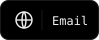

<!---https://github.com/Ileriayo/markdown-badges-->
<!---https://github.com/wewesss/ghstats-->

<!-- 

  <picture>
    <source media="(prefers-color-scheme: dark)" srcset="ghstats/identity-dark.svg">
    <source media="(prefers-color-scheme: light)" srcset="ghstats/identity-light.svg">
    
  </picture>

 -->

## 👋 About me

- 🏫 Curently at 42 Le Havre

- 🔎 Looking for a work-study programme in Unreal Engine / C++

- 👨‍💻 I'm actually learning Unreal Engine, C++ and React

## 📊 Stats

  <picture>
    <source media="(prefers-color-scheme: dark)" srcset="ghstats/stats-dark.svg">
    <source media="(prefers-color-scheme: light)" srcset="ghstats/stats-light.svg">
    
  </picture>

## 💼 Stacks
### 🎨 Languagues

### 🔧 Tools

### 🧩 Applications

## 📩 Contact me

  <a href="https://discord.com/users/532959488722862081">
    <picture>
      <source media="(prefers-color-scheme: dark)" srcset="ghstats/links/discord-dark.svg">
      <source media="(prefers-color-scheme: light)" srcset="ghstats/links/discord-light.svg">
      
    </picture>
  </a>
  <a href="https://www.youtube.com/@Banes_">
    <picture>
      <source media="(prefers-color-scheme: dark)" srcset="ghstats/links/youtube-dark.svg">
      <source media="(prefers-color-scheme: light)" srcset="ghstats/links/youtube-light.svg">
      
    </picture>
  </a>
  <a href="https://mail.google.com/mail/u/0/#inbox?compose=GTvVlcSMTtRsJBMrCDGwqHMtPQTKvTKSNkmvLtSSJtbMPhkwJsWstRbHMdNGkTh">
    <picture>
      <source media="(prefers-color-scheme: dark)" srcset="ghstats/links/custom-dark.svg">
      <source media="(prefers-color-scheme: light)" srcset="ghstats/links/custom-light.svg">
      
    </picture>
  </a>

## 👀 Views

  <picture>
    <source media="(prefers-color-scheme: dark)" srcset="ghstats/stats-dark.svg">
    <source media="(prefers-color-scheme: light)" srcset="ghstats/stats-light.svg">
    
  </picture>

