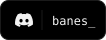

<!---https://github.com/Ileriayo/markdown-badges-->
<!---https://github.com/wewesss/ghstats-->

  <picture>
    <source media="(prefers-color-scheme: dark)" srcset="ghstats/identity-dark.svg">
    <source media="(prefers-color-scheme: light)" srcset="ghstats/identity-light.svg">
    
  </picture>

  
  
  

## A propos

- Etudiant a **42 Le Havre**
- Recherche une **alternance Unreal Engine / C++**
- Construction d'applications, de moteurs de jeu et d'experiences interactives
- Apprentissage actif de **C++**, **Unreal Engine**, **React** et du developpement logiciel

## GitHub

  <picture>
    <source media="(prefers-color-scheme: dark)" srcset="ghstats/stats-dark.svg">
    <source media="(prefers-color-scheme: light)" srcset="ghstats/stats-light.svg">
    
  </picture>

## Stack

### Outils

### Systeme

## Me contacter

  <a href="https://discord.com/users/532959488722862081">
    <picture>
      <source media="(prefers-color-scheme: dark)" srcset="ghstats/links/discord-dark.svg">
      <source media="(prefers-color-scheme: light)" srcset="ghstats/links/discord-light.svg">
      
    </picture>
  </a>
  <a href="https://www.youtube.com/@Banes_">
    <picture>
      <source media="(prefers-color-scheme: dark)" srcset="ghstats/links/youtube-dark.svg">
      <source media="(prefers-color-scheme: light)" srcset="ghstats/links/youtube-light.svg">
      
    </picture>
  </a>

  

